<!-- rq223-banner -->
<p align="center">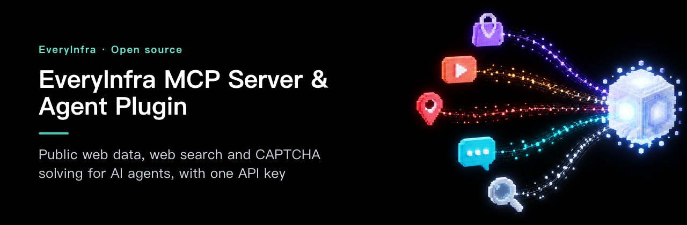</p>

<p align="center">
  <picture>
    <source media="(prefers-color-scheme: dark)" srcset="assets/hero-dark.svg">
    <source media="(prefers-color-scheme: light)" srcset="assets/hero-light.svg">
    
  </picture>
</p>

<p align="center">
  <a href="https://cursor.com/en/install-mcp?name=everyinfra&config=eyJ1cmwiOiJodHRwczovL2FwaS5ldmVyeWluZnJhLmNvbS9tY3AiLCJoZWFkZXJzIjp7IkF1dGhvcml6YXRpb24iOiJCZWFyZXIgPEFQSSBLZXk%2BIn19"><picture><source media="(prefers-color-scheme: dark)" srcset="https://cursor.com/deeplink/mcp-install-light.svg"></picture></a>
  <a href="https://vscode.dev/redirect/mcp/install?name=everyinfra&config=%7B%22type%22%3A%22http%22%2C%22url%22%3A%22https%3A%2F%2Fapi.everyinfra.com%2Fmcp%22%2C%22headers%22%3A%7B%22Authorization%22%3A%22Bearer%20%3CAPI%20Key%3E%22%7D%7D"></a>
  <a href="#claude-code"></a>
  <a href="#codex"></a>
  <a href="https://glama.ai/mcp/connectors/io.github.xiaoxihexiaoyu/everyinfra"></a>
</p>

<p align="center">
  <a href="https://github.com/everyinfra/everyinfra-agent-plugins/stargazers"></a>
  &nbsp;<b>Star this repo and get $1 in credit.</b> <a href="https://everyinfra.com/en/docs?utm_source=github&utm_medium=readme&utm_campaign=everyinfra-agent-plugins&utm_content=star_line#quickstart">How to claim →</a>
</p>

<p align="center"><b>English</b> · <a href="i18n/README.zh-CN.md">简体中文</a> · <a href="i18n/README.es.md">Español</a></p>

# EveryInfra MCP Server & Agent Plugin

One API key and one MCP endpoint for public web data: **414 data APIs across 90 platforms**, 17 web search tools and CAPTCHA solving for 52 types. From $0.56 per 1,000 calls; failed or empty calls are not charged.

<table>
<tr><th width="50%">Without EveryInfra</th><th width="50%">With EveryInfra</th></tr>
<tr><td valign="top">

- ❌ Your agent can't read  TikTok,  Instagram or  Xiaohongshu: logins and blocked requests stop it.
- ❌ One scraper per platform, rewritten every time the page changes.
- ❌ You pay for runs that return nothing.

</td><td valign="top">

- ✅ Your agent picks the API and checks the inputs itself.
- ✅ Every platform comes back in the same JSON shape.
- ✅ Failed or empty calls are not charged.

</td></tr>
</table>

<!-- rq223-listed -->
## Listed on 7 directories

Each card opens our listing on that directory.

<p align="center">
  <a href="https://modelscope.cn/mcp/servers/xiaoyuaimaomao/EveryInfra">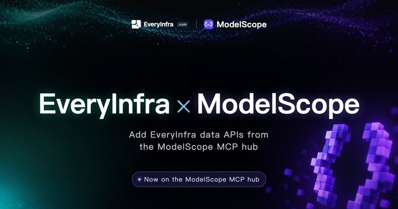</a>
  <a href="https://smithery.ai/servers/everyinfra/api">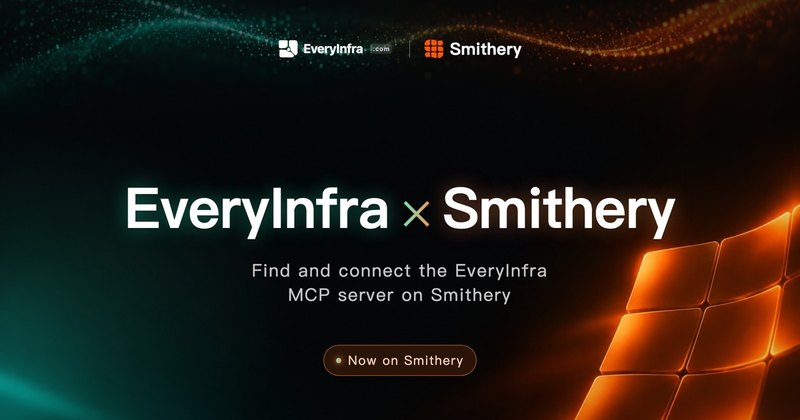</a>
  <a href="https://cursor.directory/plugins/everyinfra-tiktok-instagram-amazon-data">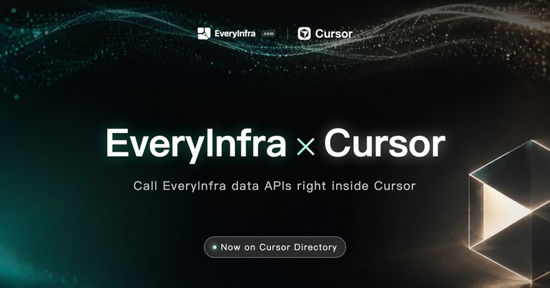</a>
  <a href="https://clawhub.ai/skills/everyinfra">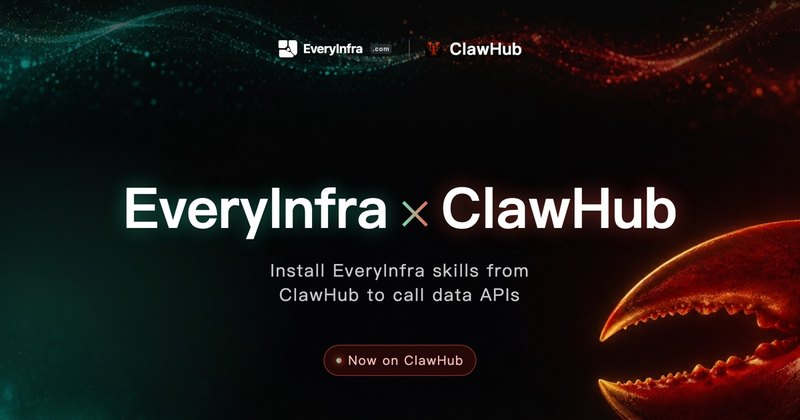</a>
  <a href="https://registry.modelcontextprotocol.io/v0/servers?search=everyinfra">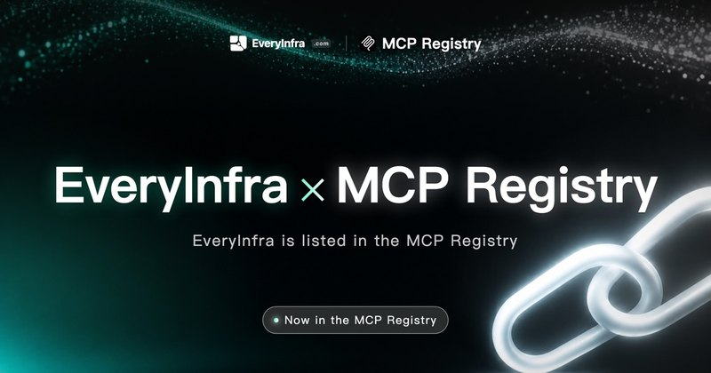</a>
  <a href="https://glama.ai/mcp/connectors/io.github.xiaoxihexiaoyu/everyinfra">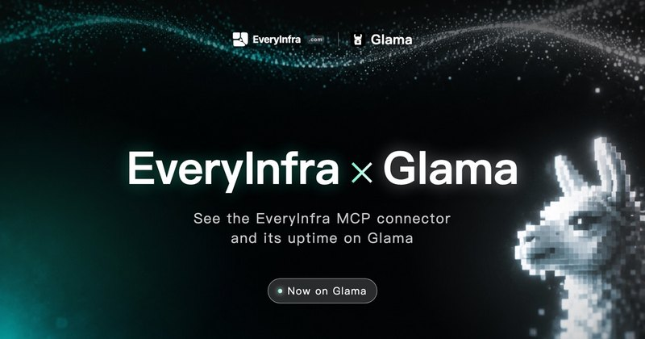</a>
  <a href="https://integrations.sh/everyinfra.com">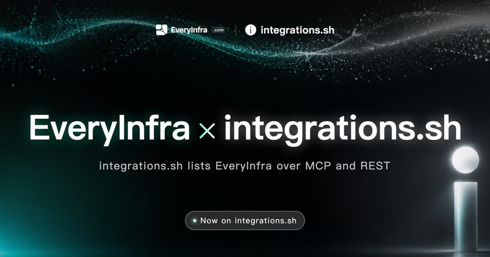</a>
</p>

## 90 platforms, one JSON shape

<p align="center">
  <picture>
    <source media="(prefers-color-scheme: dark)" srcset="assets/platform-wall-en-dark.svg">
    <source media="(prefers-color-scheme: light)" srcset="assets/platform-wall-en-light.svg">
    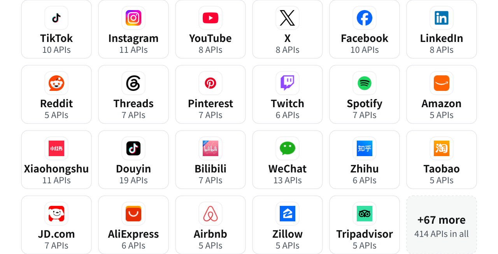
  </picture>
</p>

<p align="center"><a href="https://everyinfra.com/en/market?utm_source=github&utm_medium=readme&utm_campaign=everyinfra-agent-plugins&utm_content=all_platforms"><b>All 90 platforms and their APIs →</b></a></p>

## Quick start

**1. Get an API key** at [everyinfra.com](https://everyinfra.com/en/docs?utm_source=github&utm_medium=readme&utm_campaign=everyinfra-agent-plugins&utm_content=quickstart#quickstart). Listing the tools works without a key.

**2. Add it to your agent.**

<a id="claude-code"></a>* Claude Code*

```bash
claude mcp add --transport http everyinfra https://api.everyinfra.com/mcp \
  --header "Authorization: Bearer <API Key>"
```

<a id="codex"></a>* Codex*

```bash
export EVERYINFRA_API_KEY="<API Key>"
codex mcp add everyinfra --url https://api.everyinfra.com/mcp \
  --bearer-token-env-var EVERYINFRA_API_KEY
```

** Cursor /  VS Code**: click the install button at the top, then replace `<API Key>`.

**3. Ask in plain words.** Your agent calls `everyinfra_call_api`:

```txt
Find the top 30 Amazon results for "standing desk" and compare price, rating and review count.
```

## MCP, plugin or REST?

| You want | Use | You get |
| --- | --- | --- |
| Live tools in an agent | Remote MCP | `https://api.everyinfra.com/mcp`, current tool schemas |
| Reusable workflows | This plugin | 10 skills (router, 7 products, 2 workflows) plus MCP metadata |
| An app or a CI job | REST / SDK | [API docs](https://everyinfra.com/en/docs?utm_source=github&utm_medium=readme&utm_campaign=everyinfra-agent-plugins&utm_content=path_rest), Python and Node clients |

Plugin install for  Codex,  Claude Code,  Cursor,  GitHub Copilot,  Qoder,  CodeBuddy and  Kimi Code: see [Plugin install by host](#plugin-install-by-host).

## Community

[ Discord](https://discord.gg/9f6KmfekZC) · [ Telegram: Everyinfra bot](https://t.me/everyinfra_bot) · [Issues](https://github.com/everyinfra/everyinfra-agent-plugins/issues) · [Pricing](https://everyinfra.com/en/pricing?utm_source=github&utm_medium=readme&utm_campaign=everyinfra-agent-plugins&utm_content=community_pricing)

Listed on [ Glama](https://glama.ai/mcp/connectors/io.github.xiaoxihexiaoyu/everyinfra) · [ Smithery](https://smithery.ai/servers/everyinfra/api) · [ Cursor Directory](https://cursor.directory/plugins/everyinfra-tiktok-instagram-amazon-data) · [ ModelScope MCP](https://www.modelscope.cn/mcp/servers/xiaoyuaimaomao/EveryInfra) · [ ClawHub](https://clawhub.ai/skills/everyinfra) · [integrations.sh](https://integrations.sh/everyinfra.com) · the official  MCP Registry (`io.github.xiaoxihexiaoyu/everyinfra`).

<sub>Numbers come from the live catalog on 2026-10-24. The live catalog and MCP tool schemas are authoritative.</sub>

---

## What is in this repository

This repository packages the EveryInfra agent plugin and the remote MCP connection metadata. It is
not a copy of the EveryInfra backend. It contains:

- 10 discoverable skills: one router, seven product skills, and two outcome workflows;
- remote MCP connection metadata for `https://api.everyinfra.com/mcp`;
- host-specific plugin manifests for  Codex,  Claude Code,  Cursor,  Qoder,  CodeBuddy, and  Kimi;
- self-hosted marketplace manifests for  Codex,  Claude Code,  Cursor,  GitHub Copilot,  Qoder, and
   CodeBuddy;
- package sources for markets that take uploads ( MiniMax,  Qoder/ QoderWork,  ClawHub) under
  `host-packages/`;
- presentation assets and safety boundaries for paid calls, credentials, billing, and external side
  effects.

No API key, customer data, credential, or private gateway source code belongs in this repository.

MCP and plugins are different layers. MCP is the runtime protocol for live tools, resources,
prompts, and server instructions. A plugin is an installable package that can bundle skills, MCP
connection metadata, hooks, UI assets, and host-specific discovery metadata. Either layer can be
used without the other. Many hosts show the installed package through its skills: seeing
`everyinfra`, `everysearch`, or the other child skills in a skill list is expected, and it does not
by itself prove that the MCP connection is authenticated. See
[MCP, plugin, app, and marketplace boundaries](docs/architecture.md).

## What agents can use it for

- "Find current sources for this claim and cross-check them."
- "Discover the right public-data capability, then export a bounded CSV."
- "Search public profiles, posts, comments, listings, or reviews as structured data."
- "Clean and label these collected comments with the AI API, and return JSON."
- "Solve this captcha for a target I am authorized to automate."
- "Inspect available phone-number, transactional-email, or proxy options before I approve an
  order or send."

AI discovery terms include: **EveryInfra, EveryData, EverySearch, EveryAI, EverySolve,
EveryNumber, EveryMail, EveryProxy, MCP, web search, cited research, structured public data,
social data, ecommerce data, bulk export, captcha, phone verification, transactional email, and
proxy API**.

For an AI agent:

1. Use the `everyinfra` router when the user names EveryInfra, needs more than one product, or has
   not chosen a product.
2. Use a product skill directly when the requested outcome is unambiguous.
3. Discover live MCP capabilities and schemas before inventing parameters or estimating cost.
4. Treat purchases, sends, rentals, captcha solves, and credential delivery as explicit external
   actions. A read or draft request is not authorization to execute them.
5. Keep EveryNumber, EveryMail, and EveryProxy on their documented REST paths until live MCP
   discovery proves otherwise.

## Capability matrix

| Product or workflow | Package entry | Runtime path | Typical outcome |
| --- | --- | --- | --- |
| EveryInfra | `everyinfra` | Router | Choose the correct product and execution boundary. |
| EveryData | `everydata` | MCP | Discover and retrieve structured public-platform data. |
| EverySearch | `everysearch` | MCP | Search, read, crawl, and cross-check current public sources. |
| EveryAI | `everyai` | MCP | Run OpenAI-compatible text generation through EveryInfra. |
| EverySolve | `everysolve` | MCP | Handle an authorized captcha or anti-bot challenge. |
| EveryNumber | `everynumber` | REST guidance | Inspect or operate authorized number activation and rental flows. |
| EveryMail | `everymail` | REST guidance | Inspect, draft, schedule, or send transactional email with authorization. |
| EveryProxy | `everyproxy` | REST guidance | Inspect packages, order, and retrieve credentials with authorization. |
| Cross-check research | `everyinfra-crosscheck-research` | MCP workflow | Produce an evidence-backed answer from distinct retrieval paths. |
| Bulk data export | `everyinfra-bulk-data-export` | MCP workflow | Export bounded, deduplicated CSV or JSON with cost controls. |

The live capability catalog and tool schemas are authoritative. The package must not invent an MCP
tool name, current price, availability state, or billing result.

**AI API route.** Use the MCP tool `everyinfra_chat`, or REST
`POST https://api.everyinfra.com/api/v1/chat/completions` with any  OpenAI SDK (`base_url` =
`https://api.everyinfra.com/api/v1`, same API key). It is free for accounts that have topped up;
per-minute limits follow cumulative top-ups (50 under $100, 500 from $100, 5,000 from $500, all keys
combined). It is meant for organizing the data you collect with EveryInfra.

## Live numbers and activity

<!-- readme-stats: charts are regenerated daily, do not edit by hand -->

The badges read the live catalogs on every page view. The two charts are regenerated every day, from the same catalogs and from the git history of all EveryInfra repositories, including the private gateway (counts only); each chart prints its update time.

<p>   </p>

<picture>
  <source media="(prefers-color-scheme: dark)" srcset="assets/readme-stats/coverage-en-dark.svg">
  <source media="(prefers-color-scheme: light)" srcset="assets/readme-stats/coverage-en-light.svg">
  
</picture>

### How a call flows

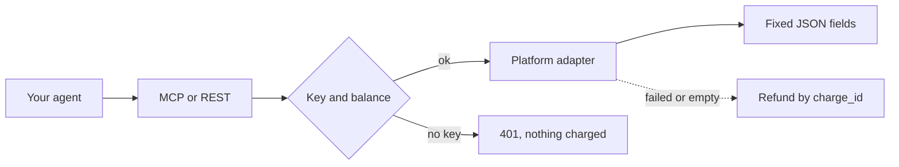

<picture>
  <source media="(prefers-color-scheme: dark)" srcset="assets/readme-stats/activity-en-dark.svg">
  <source media="(prefers-color-scheme: light)" srcset="assets/readme-stats/activity-en-light.svg">
  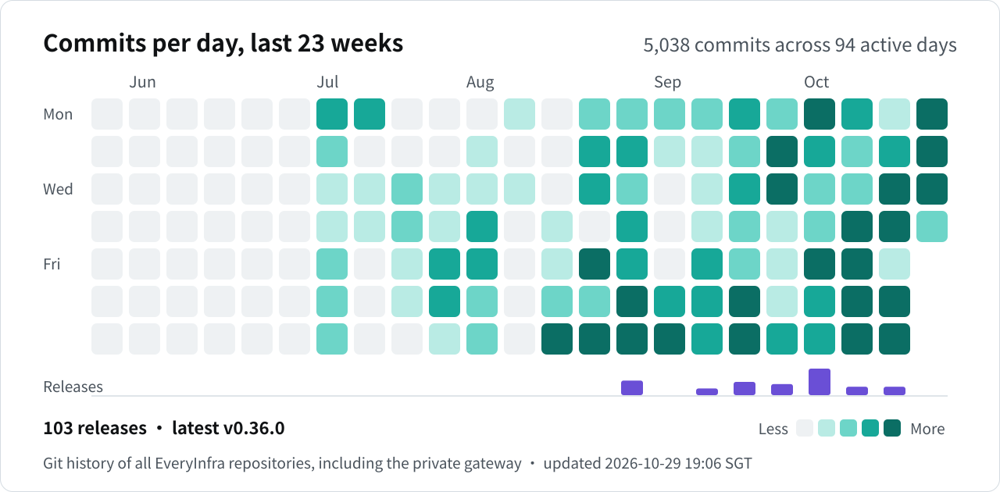
</picture>

## Status: what exists today

| Layer | Repository state | What is not implied |
| --- | --- | --- |
| Remote MCP | Production advertises 25 tools at `https://api.everyinfra.com/mcp`: capability list, data call and job status, AI chat, CAPTCHA types and solve, web search, plus account, usage, billing, API key, settings, webhook and ticket tools. | Discovery is not proof that an account is authenticated or has the balance or top-up a call requires. |
| Plugin package | Portable and host-specific manifests, skills, MCP metadata, and assets are present. | Presence is not a clean-host installation test. |
| Repository validator | Cross-host JSON, path, skill, MCP, and credential-safety checks are available. | Repository validation is not marketplace approval. |
| Self-hosted catalogs | Six marketplace manifests ( Codex,  Claude Code,  Cursor,  GitHub Copilot,  Qoder,  CodeBuddy) and a  Kimi Code root manifest are present in this repository. | A catalog file is not an official listing. |
| Market upload packages |  MiniMax (CN and US),  Qoder/ QoderWork skills and expert kit, and  ClawHub skills are built from `host-packages/` and pass `scripts/build_host_packages.py check`. | Not submitted to or approved by any of these markets. |
|  OpenAI registered app | No `.app.json` or host-issued app ID is included. | Direct MCP metadata is not a registered  ChatGPT connector. |
| Directories | Listed on  Glama,  Smithery,  Cursor Directory,  ModelScope and the official  MCP Registry (links under Community). | A directory listing is not an official  Codex,  Claude or  Cursor marketplace approval. |
|  WorkBuddy connectors | Connector packages for the  WorkBuddy open platform are prepared under `workbuddy/` and pass `scripts/build_workbuddy.py check`. | Not submitted to or approved by  WorkBuddy. |

Release claims should distinguish **prepared**, **validated**, **installed**, **submitted**, and
**listed**. Do not collapse them into one status.

## Plugin install by host

An EveryInfra API key is required for paid operations; listing tools works without one. Keep the
key in the installing host's secret or environment configuration, never in a manifest, prompt,
committed file, or URL query string.

```bash
export EVERYINFRA_API_KEY="<API Key>"
```

###  Codex

```bash
codex plugin marketplace add everyinfra/everyinfra-agent-plugins
codex plugin add everyinfra@everyinfra
codex mcp add everyinfra \
  --url https://api.everyinfra.com/mcp \
  --bearer-token-env-var EVERYINFRA_API_KEY
```

The explicit MCP entry is separate because a distributable plugin must not contain a real bearer
token. Start a new task after installing so  Codex discovers the new skills and tools. A local clone
also works: `codex plugin marketplace add <path-to-this-repository>`. These commands are an
installation path, not evidence of an official  Codex marketplace listing.

###  Claude Code

```bash
claude plugin marketplace add everyinfra/everyinfra-agent-plugins
claude plugin install everyinfra@everyinfra
```

Configure the sensitive `api_token` value through  Claude Code's plugin configuration flow. Avoid
putting a real token on a shell command line because shell history can retain it.

###  Cursor

For local development, copy or symlink `plugins/everyinfra` to
`~/.cursor/plugins/local/everyinfra`, reload  Cursor, and set `EVERYINFRA_API_KEY` through  Cursor's
plugin configuration. A team can import the repository through its own marketplace process. The
presence of `.cursor-plugin/marketplace.json` does not claim an official  Cursor listing. Users who
only need tools can use the **Install in  Cursor** button above.

###  GitHub Copilot and Agent Plugins 1.0 clients

The GitHub catalog is at `.github/plugin/marketplace.json`; the portable package starts at
`plugins/everyinfra/plugin.json`. Use the marketplace or local-plugin flow supported by your client.
Host support and secret injection differ, so confirm that the client reads `EVERYINFRA_API_KEY`
before making a paid call. The portable `mcp.json` deliberately contains no authorization header.

###  Qoder CLI

```bash
qoder plugins marketplace add everyinfra/everyinfra-agent-plugins
qoder plugins install everyinfra
```

The catalog is `.qoder-plugin/marketplace.json`; the package manifest is
`plugins/everyinfra/.qoder-plugin/plugin.json`.  Qoder loads the skills and the bundled `.mcp.json`,
which reads the key from `EVERYINFRA_API_KEY`. A local clone also works:
`qoder plugins install ./plugins/everyinfra`.

###  CodeBuddy Code

```text
/plugin marketplace add everyinfra/everyinfra-agent-plugins
/plugin install everyinfra@everyinfra
```

The catalog is `.codebuddy-plugin/marketplace.json`; the package manifest is
`plugins/everyinfra/.codebuddy-plugin/plugin.json`.  CodeBuddy asks for the sensitive `api_token`
value when the plugin is enabled and sends it as the `Authorization: Bearer` header.

###  Kimi Code

```text
/plugins install https://github.com/everyinfra/everyinfra-agent-plugins/tree/main
```

The root manifest `.kimi-plugin/plugin.json` loads the ten skills from `plugins/everyinfra/skills/`
and declares the remote MCP server at `https://api-cn.everyinfra.com/mcp` (same server and keys as
`api.everyinfra.com`, reachable from mainland China). The manifest carries no key, so listing tools
works out of the box; for paid calls, add the same server with an `Authorization: Bearer` header in
 Kimi Code's MCP configuration. A bare repository URL installs the latest GitHub Release (0.4.0 and
later include this manifest); the `/tree/main` form installs the current main branch.

### Markets that take uploads

 MiniMax,  Qoder/QoderWork and  ClawHub want their own packages. Their manifests and listing metadata
live in `host-packages/`; the skill bodies always come from `plugins/everyinfra/skills/`.
`python3 scripts/build_host_packages.py build` writes the packages to `dist/host-packages/` and does
not upload or submit anything. See `host-packages/README.md` for what each market receives.

### SDK release attachments

The `v0.2.0` GitHub Release distributes the official Python and Node clients as release attachments.
These URLs are the supported direct-install path for this version; they do not claim that an npm or
PyPI package with the same name has been published.

```bash
python -m pip install \
  https://github.com/everyinfra/everyinfra-agent-plugins/releases/download/v0.2.0/everyinfra-0.2.0-py3-none-any.whl
npm install \
  https://github.com/everyinfra/everyinfra-agent-plugins/releases/download/v0.2.0/everyinfra-0.2.0.tgz
```

## Repository layout

```text
.agents/plugins/marketplace.json              Codex self-hosted marketplace
.claude-plugin/marketplace.json               Claude Code self-hosted marketplace
.cursor-plugin/marketplace.json               Cursor self-hosted marketplace
.github/plugin/marketplace.json               GitHub Copilot-compatible catalog
.qoder-plugin/marketplace.json                Qoder CLI self-hosted marketplace
.codebuddy-plugin/marketplace.json            CodeBuddy Code self-hosted marketplace
.kimi-plugin/plugin.json                      Kimi Code root manifest (install from the repository URL)
plugins/everyinfra/plugin.json                Agent Plugins 1.0 package manifest
plugins/everyinfra/.<host>-plugin/plugin.json Codex, Claude Code, Cursor, Qoder and CodeBuddy manifests
plugins/everyinfra/mcp*.json                   Portable and host-specific MCP metadata
plugins/everyinfra/skills/                     Router, product, and outcome skills
plugins/everyinfra/assets/                     Plugin icon and light/dark logos
assets/                                        README hero images and platform icons
i18n/                                          README in Simplified Chinese and Spanish
workbuddy/                                     WorkBuddy connector packages (MCP + Skill)
host-packages/                                 MiniMax, Qoder/QoderWork and ClawHub package sources
llms-install.md                                Install steps for agents that set up MCP servers
```

## Validate and contribute

```bash
python3 scripts/validate.py
python3 scripts/build_workbuddy.py check
python3 scripts/build_host_packages.py check
python3 scripts/build_release.py --check-source
```

Run host validators that are available in your environment and report unavailable validators as
skipped, not passed, for example `claude plugin validate plugins/everyinfra --strict`.

Read [installation details](docs/installation.md), [troubleshooting](docs/troubleshooting.md),
[permissions and billing](docs/permissions.md), and the [REST-only boundary](docs/rest-only.md)
before using paid or state-changing operations. Contributions are welcome through
[CONTRIBUTING.md](CONTRIBUTING.md); include the affected host, manifest or skill, evidence for
changed API behavior, and the validation command you ran.

<sub>Platform icons: [Simple Icons](https://simpleicons.org) (CC0). Brand names and logos belong to their owners.</sub>
