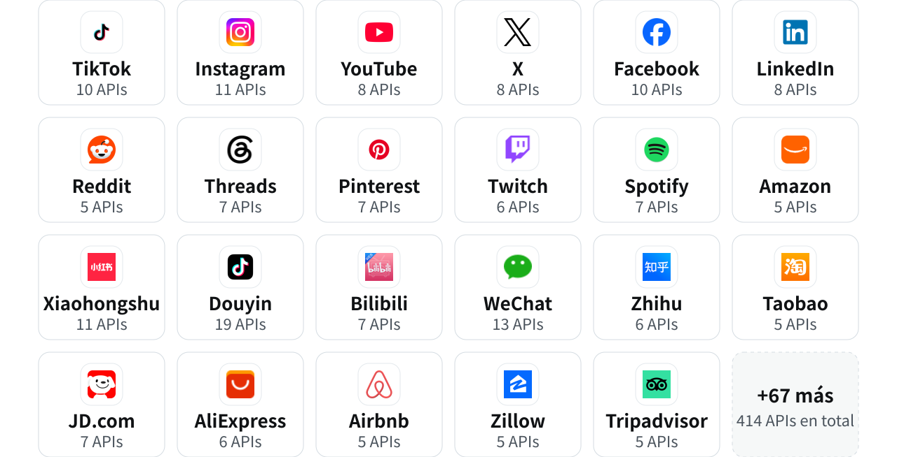

<p align="center">
  <picture>
    <source media="(prefers-color-scheme: dark)" srcset="../assets/hero-es-dark.svg">
    <source media="(prefers-color-scheme: light)" srcset="../assets/hero-es-light.svg">
    
  </picture>
</p>

<p align="center">
  <a href="https://cursor.com/en/install-mcp?name=everyinfra&config=eyJ1cmwiOiJodHRwczovL2FwaS5ldmVyeWluZnJhLmNvbS9tY3AiLCJoZWFkZXJzIjp7IkF1dGhvcml6YXRpb24iOiJCZWFyZXIgPEFQSSBLZXk%2BIn19"></a>
  <a href="https://vscode.dev/redirect/mcp/install?name=everyinfra&config=%7B%22type%22%3A%22http%22%2C%22url%22%3A%22https%3A%2F%2Fapi.everyinfra.com%2Fmcp%22%2C%22headers%22%3A%7B%22Authorization%22%3A%22Bearer%20%3CAPI%20Key%3E%22%7D%7D"></a>
  <a href="#claude-code"></a>
  <a href="#codex"></a>
</p>

<p align="center">
  <a href="https://github.com/everyinfra/everyinfra-agent-plugins/stargazers"></a>
  &nbsp;<b>Dale una estrella al repo y recibe $1 de saldo.</b> <a href="https://everyinfra.com/es/docs?utm_source=github&utm_medium=readme&utm_campaign=everyinfra-agent-plugins&utm_content=star_line#quickstart">Cómo reclamarlo →</a>
</p>

<p align="center"><a href="../README.md">English</a> · <a href="README.zh-CN.md">简体中文</a> · <b>Español</b></p>

# Servidor MCP y plugin para agentes de EveryInfra

Una clave de API y un endpoint MCP para datos públicos de la web: **414 APIs de datos en 90 plataformas**, 17 herramientas de búsqueda web y resolución de CAPTCHA para 52 tipos. Desde $0.56 por 1.000 llamadas; las llamadas fallidas o vacías no se cobran.

<table>
<tr><th width="50%">Sin EveryInfra</th><th width="50%">Con EveryInfra</th></tr>
<tr><td valign="top">

- ❌ Tu agente no puede leer TikTok, Instagram ni Xiaohongshu: los inicios de sesión y los bloqueos lo detienen.
- ❌ Un scraper por plataforma, que hay que reescribir cada vez que cambia la página.
- ❌ Pagas por ejecuciones que no devuelven nada.

</td><td valign="top">

- ✅ Tu agente elige la API y valida los parámetros por sí mismo.
- ✅ Todas las plataformas responden con la misma estructura JSON.
- ✅ Las llamadas fallidas o vacías no se cobran.

</td></tr>
</table>

## 90 plataformas, una sola estructura JSON

<p align="center">
  <picture>
    <source media="(prefers-color-scheme: dark)" srcset="../assets/platform-wall-es-dark.svg">
    <source media="(prefers-color-scheme: light)" srcset="../assets/platform-wall-es-light.svg">
    
  </picture>
</p>

<p align="center"><a href="https://everyinfra.com/es/market?utm_source=github&utm_medium=readme&utm_campaign=everyinfra-agent-plugins&utm_content=all_platforms"><b>Las 90 plataformas y sus APIs →</b></a></p>

## Empieza en tres pasos

**1. Consigue una clave de API** en [everyinfra.com](https://everyinfra.com/es/docs?utm_source=github&utm_medium=readme&utm_campaign=everyinfra-agent-plugins&utm_content=quickstart#quickstart). Para listar las herramientas no hace falta clave.

**2. Añádelo a tu agente.**

<a id="claude-code"></a>*Claude Code*

```bash
claude mcp add --transport http everyinfra https://api.everyinfra.com/mcp \
  --header "Authorization: Bearer <API Key>"
```

<a id="codex"></a>*Codex*

```bash
export EVERYINFRA_API_KEY="<API Key>"
codex mcp add everyinfra --url https://api.everyinfra.com/mcp \
  --bearer-token-env-var EVERYINFRA_API_KEY
```

**Cursor / VS Code**: pulsa el botón de instalación de arriba y sustituye `<API Key>`.

**3. Pregunta con tus palabras.** Tu agente llama a `everyinfra_call_api`:

```txt
Busca los 30 primeros resultados de «standing desk» en Amazon y compara precio, valoración y número de reseñas.
```

## ¿MCP, plugin o REST?

| Quieres | Usa | Obtienes |
| --- | --- | --- |
| Herramientas en vivo dentro de un agente | MCP remoto | `https://api.everyinfra.com/mcp`, esquemas de herramientas actuales |
| Flujos de trabajo reutilizables | Este plugin | 10 skills (1 router, 7 productos, 2 flujos) y metadatos MCP |
| Una aplicación o un job de CI | REST / SDK | [Documentación de la API](https://everyinfra.com/es/docs?utm_source=github&utm_medium=readme&utm_campaign=everyinfra-agent-plugins&utm_content=path_rest_es), clientes de Python y Node |

La instalación del plugin en cada host (Codex, Claude Code, Cursor, GitHub Copilot, Qoder, CodeBuddy y Kimi Code), la estructura del repositorio y los comandos de validación están en la versión en inglés: [Plugin install by host](../README.md#plugin-install-by-host).

## Comunidad

[Discord](https://discord.gg/9f6KmfekZC) · [Telegram: Everyinfra bot](https://t.me/everyinfra_bot) · [Issues](https://github.com/everyinfra/everyinfra-agent-plugins/issues) · [Precios](https://everyinfra.com/es/pricing?utm_source=github&utm_medium=readme&utm_campaign=everyinfra-agent-plugins&utm_content=community_pricing_es)

Disponible en [Glama](https://glama.ai/mcp/connectors/io.github.xiaoxihexiaoyu/everyinfra) · [Smithery](https://smithery.ai/servers/everyinfra/api) · [Cursor Directory](https://cursor.directory/plugins/everyinfra-tiktok-instagram-amazon-data) · [ModelScope MCP](https://www.modelscope.cn/mcp/servers/xiaoyuaimaomao/EveryInfra) · el registro oficial de MCP (`io.github.xiaoxihexiaoyu/everyinfra`).

<sub>Cifras del catálogo en vivo del 2026-10-24. El catálogo en vivo y los esquemas de las herramientas MCP son la referencia. Iconos de plataformas: [Simple Icons](https://simpleicons.org) (CC0); los nombres y logotipos pertenecen a sus titulares.</sub>
