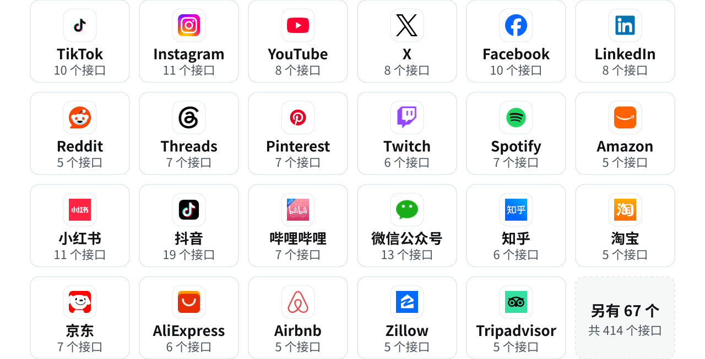
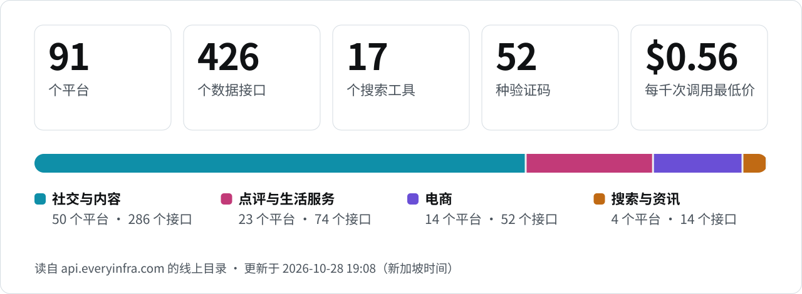
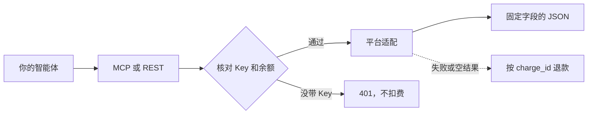
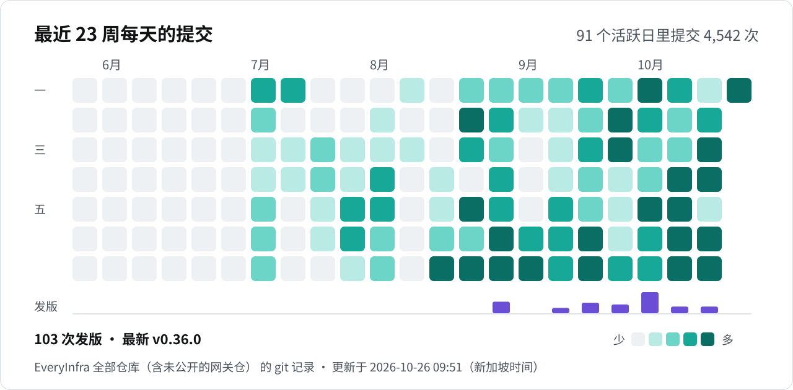

<p align="center">
  <picture>
    <source media="(prefers-color-scheme: dark)" srcset="../assets/hero-zh-dark.svg">
    <source media="(prefers-color-scheme: light)" srcset="../assets/hero-zh-light.svg">
    
  </picture>
</p>

<p align="center">
  <a href="https://cursor.com/en/install-mcp?name=everyinfra&config=eyJ1cmwiOiJodHRwczovL2FwaS5ldmVyeWluZnJhLmNvbS9tY3AiLCJoZWFkZXJzIjp7IkF1dGhvcml6YXRpb24iOiJCZWFyZXIgPEFQSSBLZXk%2BIn19"></a>
  <a href="https://vscode.dev/redirect/mcp/install?name=everyinfra&config=%7B%22type%22%3A%22http%22%2C%22url%22%3A%22https%3A%2F%2Fapi.everyinfra.com%2Fmcp%22%2C%22headers%22%3A%7B%22Authorization%22%3A%22Bearer%20%3CAPI%20Key%3E%22%7D%7D"></a>
  <a href="#claude-code"></a>
  <a href="#codex"></a>
</p>

<p align="center">
  <a href="https://github.com/everyinfra/everyinfra-agent-plugins/stargazers"></a>
  &nbsp;<b>给本仓库点个 Star，送 $1 额度。</b> <a href="https://everyinfra.com/zh/docs?utm_source=github&utm_medium=readme&utm_campaign=everyinfra-agent-plugins&utm_content=star_line#quickstart">领取方式 →</a>
</p>

<p align="center"><a href="../README.md">English</a> · <b>简体中文</b> · <a href="README.es.md">Español</a></p>

# EveryInfra MCP Server 与 Agent 插件

一个 API Key、一个 MCP 地址，拿到公开网页数据：**90 个平台的 414 个数据接口**，17 个搜索工具，52 种验证码识别。每千次调用 $0.56 起，失败或空结果不收费。

<table>
<tr><th width="50%">没有 EveryInfra</th><th width="50%">用了 EveryInfra</th></tr>
<tr><td valign="top">

- ❌ Agent 读不了  TikTok、 Instagram、 小红书：登录和拦截把它挡在外面。
- ❌ 每个平台写一套爬虫，页面一改就得重写。
- ❌ 什么都没拿到，也照样付钱。

</td><td valign="top">

- ✅ Agent 自己选接口、自己检查参数。
- ✅ 每个平台都返回同一种 JSON 结构。
- ✅ 失败或空结果不收费。

</td></tr>
</table>

## 90 个平台，一种 JSON 结构

<p align="center">
  <picture>
    <source media="(prefers-color-scheme: dark)" srcset="../assets/platform-wall-zh-dark.svg">
    <source media="(prefers-color-scheme: light)" srcset="../assets/platform-wall-zh-light.svg">
    
  </picture>
</p>

<p align="center"><a href="https://everyinfra.com/zh/market?utm_source=github&utm_medium=readme&utm_campaign=everyinfra-agent-plugins&utm_content=all_platforms"><b>查看全部 90 个平台和接口 →</b></a></p>

## 三步上手

**1. 拿一个 API Key**：在 [everyinfra.com](https://everyinfra.com/zh/docs?utm_source=github&utm_medium=readme&utm_campaign=everyinfra-agent-plugins&utm_content=quickstart#quickstart) 注册即可。只列出工具不需要 Key。

**2. 接到你的 Agent。**

<a id="claude-code"></a>* Claude Code*

```bash
claude mcp add --transport http everyinfra https://api.everyinfra.com/mcp \
  --header "Authorization: Bearer <API Key>"
```

<a id="codex"></a>* Codex*

```bash
export EVERYINFRA_API_KEY="<API Key>"
codex mcp add everyinfra --url https://api.everyinfra.com/mcp \
  --bearer-token-env-var EVERYINFRA_API_KEY
```

** Cursor /  VS Code**：点顶部的安装按钮，再把 `<API Key>` 换成你的 Key。

**3. 直接用中文提问。** Agent 会调用 `everyinfra_call_api`：

```txt
小红书搜「露营装备」，导出最近 7 天点赞最高的 50 条笔记的标题、点赞和评论数。
```

## 选 MCP、插件还是 REST？

| 你要 | 用 | 得到 |
| --- | --- | --- |
| 在 Agent 里直接调工具 | 远程 MCP | `https://api.everyinfra.com/mcp`，实时的工具定义 |
| 可复用的工作流 | 本插件 | 10 个 Skill（1 个路由、7 个产品、2 个工作流）和 MCP 元数据 |
| 写进应用或 CI | REST / SDK | [API 文档](https://everyinfra.com/docs?utm_source=github&utm_medium=readme&utm_campaign=everyinfra-agent-plugins&utm_content=path_rest_zh)、Python 和 Node 客户端 |

各宿主（ Codex、 Claude Code、 Cursor、 GitHub Copilot、 Qoder、 CodeBuddy、 Kimi Code）的插件安装、仓库结构和校验命令见英文版 [Plugin install by host](../README.md#plugin-install-by-host)。

## 实时数字与活跃度

<!-- readme-stats: charts are regenerated daily, do not edit by hand -->

徽章每次打开页面都现读线上目录。两张图每天重新生成，分别读同一份目录和 EveryInfra 全部仓库（含未公开的网关仓，只统计数量）的 git 记录，图上写着更新时间。

<p>   </p>

<picture>
  <source media="(prefers-color-scheme: dark)" srcset="../assets/readme-stats/coverage-zh-dark.svg">
  <source media="(prefers-color-scheme: light)" srcset="../assets/readme-stats/coverage-zh-light.svg">
  
</picture>

### 一次调用怎么走



<picture>
  <source media="(prefers-color-scheme: dark)" srcset="../assets/readme-stats/activity-zh-dark.svg">
  <source media="(prefers-color-scheme: light)" srcset="../assets/readme-stats/activity-zh-light.svg">
  
</picture>

## 社区

[ Discord](https://discord.gg/9f6KmfekZC) · [ Telegram：Everyinfra bot](https://t.me/everyinfra_bot) · [Issues](https://github.com/everyinfra/everyinfra-agent-plugins/issues) · [价格](https://everyinfra.com/pricing?utm_source=github&utm_medium=readme&utm_campaign=everyinfra-agent-plugins&utm_content=community_pricing_zh)

已上架 [ Glama](https://glama.ai/mcp/connectors/io.github.xiaoxihexiaoyu/everyinfra) · [ Smithery](https://smithery.ai/servers/everyinfra/api) · [ Cursor Directory](https://cursor.directory/plugins/everyinfra-tiktok-instagram-amazon-data) · [魔搭 MCP 广场](https://www.modelscope.cn/mcp/servers/xiaoyuaimaomao/EveryInfra) · 官方  MCP Registry（`io.github.xiaoxihexiaoyu/everyinfra`）。

<sub>数字取自 2026-10-24 的线上目录，以线上目录和 MCP 工具定义为准。平台图标来自 [Simple Icons](https://simpleicons.org)（CC0），品牌名称和标志归各自所有者。</sub>
